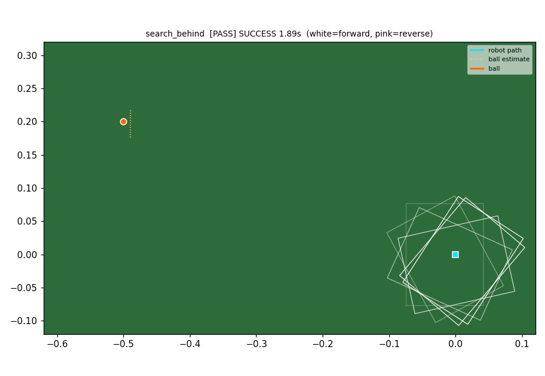
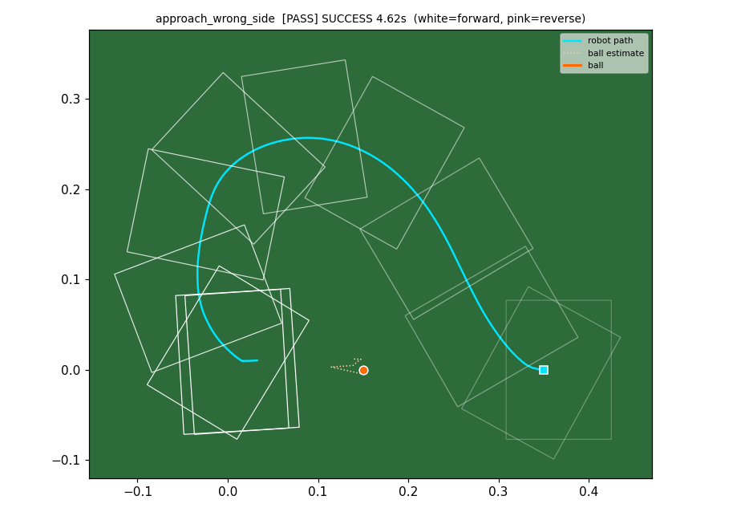
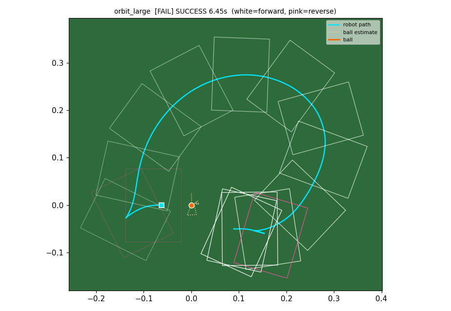
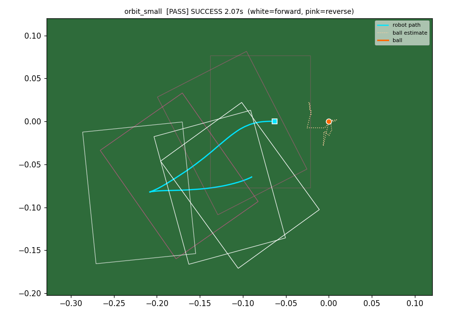
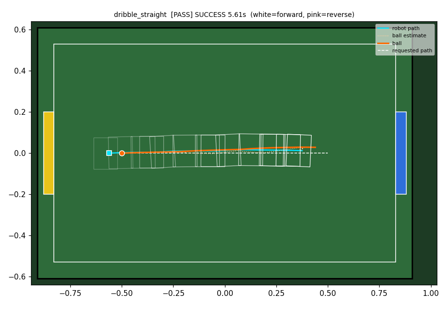
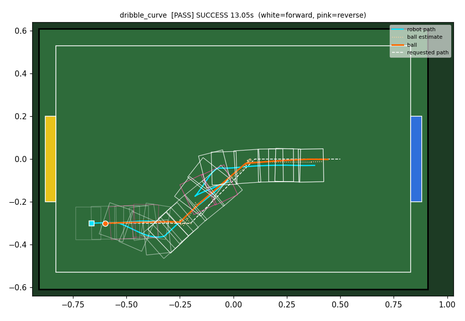
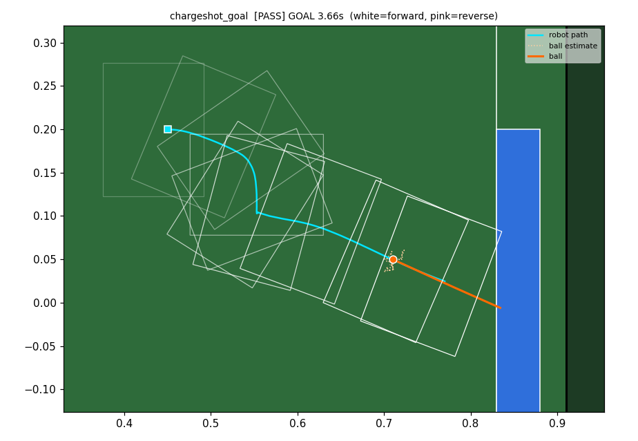
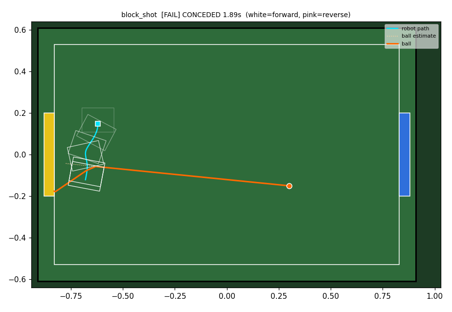
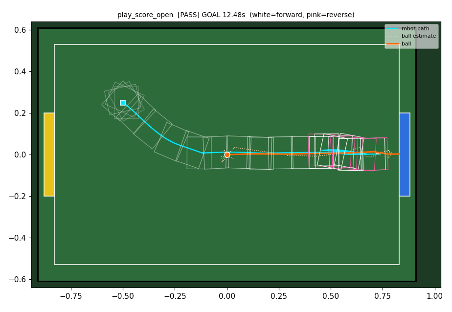
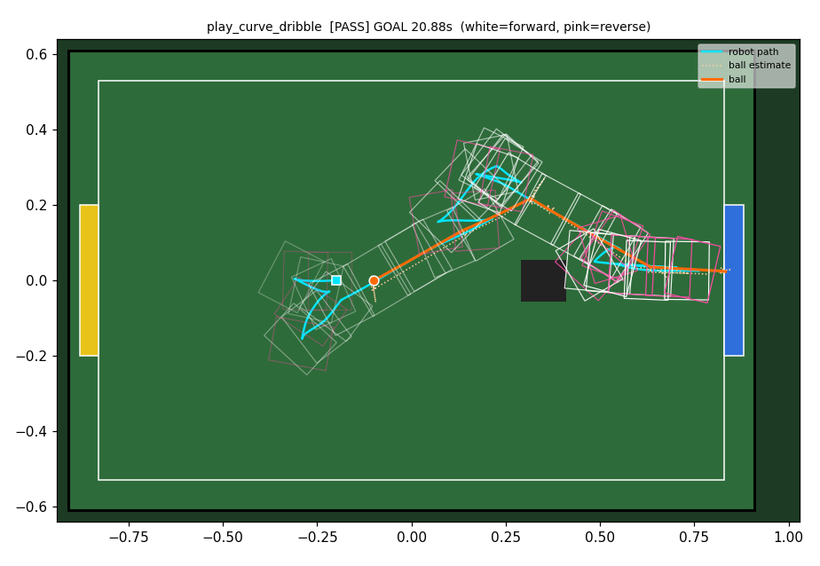

# 축구 스킬 설명서

Pinky Pro 축구 로봇이 쓰는 기본 동작(스킬)을 한 장씩 설명합니다. 스킬은 작고 검증 가능한 동작
단위이고, 플레이북은 스킬을 이어 붙여 경기 행동(공격·수비·뺏기)을 만듭니다.

- 코드: `pinky_soccer_skills/` (스킬은 `skills.py`, 조합은 `playbook.py`)
- 수치 근거: `pinky_soccer_skills/params.py` 주석, 자주 바꾸는 값은 `config/skills.yaml`
- 검증 결과는 2026-11-23 MuJoCo 시험대 기준입니다. 실물 검증은 아직 하지 않았습니다.

## 목차

1. [한눈에 보기](#1-한눈에-보기)
2. [먼저 알아둘 로봇·공의 사실](#2-먼저-알아둘-로봇공의-사실)
3. [이동 기본 동작 (L1)](#3-이동-기본-동작-l1)
4. [공 스킬 (L2)](#4-공-스킬-l2)
5. [조합 행동: 플레이북 (L3)](#5-조합-행동-플레이북-l3)
6. [시험대 사용법과 그림 읽는 법](#6-시험대-사용법과-그림-읽는-법)
7. [검증 결과 요약과 한계](#7-검증-결과-요약과-한계)

---

## 1. 한눈에 보기

```
L3 플레이북 (Striker)      탐색 → 접근 → 드리블 → 슛 / 수비 / 뺏기 를 상황마다 고름
        │ 스킬 하나를 골라 매 주기 step(ctx) 호출
L2 공 스킬                 SearchBall · ApproachBall · OrbitBall · Dribble · ChargeShot
                           RecoverBall · BlockShot · ShadowBall
        │ 이동 목표 / 속도 요청
L1 이동 기본 동작          GoToPose(후진 포함) · TurnTo · 선 따라가기 · 경로 후보 계획
L0 질의(움직임 없음)       공 위치 예측 · 요격점 · 골라인 통과점 · 상대 우회 경로
        │ (v, w)
제한기 → /cmd_vel → watchdog → 바퀴
```

| 스킬 | 한 줄 설명 | 끝나는 조건 |
|---|---|---|
| `GoToPose` | 지정 위치·방향으로 이동. 빠르면 후진 | 도착 |
| `TurnTo` | 제자리 회전 | 방향 일치 |
| `SearchBall` | 공 찾기: 마지막 위치 보기 → 제자리 한 바퀴 → 관측 지점 순회 | 공 확인 |
| `ApproachBall` | 공 앞 일정 간격에서 원하는 방향을 보고 정지. 공을 건드리지 않고 돌아감 | 자리 잡음 |
| `OrbitBall` | 공 바로 앞에서 방향만 바꾸기 (후진으로 빠졌다 다시 들어감) | 자리 잡음 |
| `Dribble` | 공을 범퍼로 밀며 경로를 따라 이동 | 경로 끝 도착 |
| `ChargeShot` | 물러났다가 가속해 치고 밀어 넣기. 세기 = 물러난 거리 | 친 뒤 마무리 |
| `RecoverBall` | 잃어버린 공 다시 보기 (범퍼 앞 사각지대면 후진) | 공 확인 |
| `BlockShot` | 우리 골대로 오는 공의 경로에 먼저 서기 | 계속 (호출자가 바꿈) |
| `ShadowBall` | 공과 우리 골대 사이에서 공을 보며 대기 | 계속 (호출자가 바꿈) |

모든 스킬은 같은 형식으로 동작합니다.

- 입력 `SkillContext`: 내 위치(map), 공 추정(위치·속도·상태·마지막 관측 후 시간), 초음파, 상대 위치, 경기장
- 출력 `SkillOutput`: 속도 요청 `(v, w)`와 상태 `RUNNING / SUCCESS / FAILURE`, 이유(`reason`), 단계(`phase`)
- 스킬은 센서나 시뮬레이터를 직접 읽지 않습니다. 그래서 시험대에서 맞춘 스킬이 실물에서 그대로 돕니다.

---

## 2. 먼저 알아둘 로봇·공의 사실

시험대에서 측정한 값입니다. 스킬 설계는 이 사실 위에 서 있습니다.

| 사실 | 값 | 출처 | 설계에 미친 영향 |
|---|---|---|---|
| 공이 범퍼에 닿으면 카메라에서 안 보임 | 간격 **약 4~5 cm 이상**이어야 보임 (원 둘레 50% 기준) | URDF 카메라(높이 63 mm, 8° 숙임, HFOV 66° 가정) | 드리블은 "톡 쳐서 떨어질 때 확인", 공 위치는 사각지대 예측기(`LocalBall`)로 유지 |
| 범퍼에 붙은 공의 중심 | base_link 앞 **0.063 m** | 범퍼 앞면 41.5 mm + 공 반지름 21.35 mm | 접촉 판정 기준 |
| 로봇 외곽(공 높이) | x −0.075~+0.0415 m, y ±0.077 m (바퀴가 범퍼보다 옆으로 나옴) | 충돌 메시 | 공 옆을 지날 때 여유 계산 |
| 범퍼 폭 | ±0.0385 m, **평평한 판** | 범퍼 v1 | 공을 끼고 크게 돌 수 없음 → 큰 방향 전환은 OrbitBall |
| 공 구름 감속 | **0.35 m/s²** (0.25 m/s로 치면 약 9 cm 굴러감) | `pinky_soccer_sim` 재질 가정값 (EVA 매트, **미실측**) | 슛은 골라인 20 cm 안에서만, 그 밖은 드리블로 운반 |
| 초음파 | 공이 붙으면 약 2~3.5 cm로 읽힘, 공이 범퍼 옆으로 흐르면 못 봄 | 시뮬레이터 광선 모델 (**미실측**) | 사각지대에서 "공이 앞에 있음"의 보조 증거 |
| 속도 상한 | 0.25 m/s, 1.5 rad/s | 공식 MuJoCo 제어 상한 | 실물은 launch 기본 0.08 m/s·0.5 rad/s로 더 낮음 |

> 공이 잘 굴러간다는 실물 관찰과 시뮬레이터 감속(0.35 m/s²)이 다를 수 있습니다. 매트 위에서 공을
> 일정 속도로 굴려 정지 거리를 재면 `ball_model.roll_decel`과 슛 사거리를 바로 고칠 수 있습니다.

---

## 3. 이동 기본 동작 (L1)

### GoToPose — 위치와 방향으로 이동

- **동작**: 극좌표 자세 제어(ρ, α, β)로 곡선을 그리며 가고, 목표 방향을 맞춰 도착합니다.
  전진과 후진 중 **예상 시간이 짧은 쪽**을 고르고, 0.25초 이상 이득일 때만 바꿉니다(왔다 갔다 방지).
- **속도**: 경로 모양(곡률)은 제어 법칙에서, 속도는 멈출 수 있는 거리 기준 사다리꼴로 정합니다.
- **입력**: `x, y, theta`
- **끝**: 위치 2 cm, 방향 0.08 rad 안
- **튜닝**: `drive.k_alpha=5`, `k_beta=-2`는 시험대 스윕으로 고른 값입니다(접근·재정렬 시나리오 합계 시간 최소).

### TurnTo — 제자리 회전

멈출 수 있는 각도 기준으로 속도를 줄여 오버슈트 없이 멈춥니다.

### 경로 후보 계획 (공 피해 가기)

공에 접근하거나 공 주위를 돌 때 쓰는 "작은 최적화"입니다.

1. 후보를 만듭니다: 직진 / 공 왼쪽·오른쪽으로 돌기(옆, 뒤옆, 앞옆 경유) / 그대로 8·15 cm 후진 후 진입 /
   **목표 방향선 뒤쪽 8·15 cm 지점으로 (보통 후진하며) 빠졌다가 직진 진입** / 상대 로봇 우회 경유.
2. 각 후보를 운동학 모델로 미리 굴려(rollout) 걸리는 시간과 공·상대와의 최소 여유를 계산합니다.
3. 공 옆·모서리·뒤와 3 cm 이상 떨어지는 후보 중 **가장 빠른 것**을 고릅니다.
   범퍼 정면으로 공에 다가가는 것은 허용합니다.
4. 0.5초마다 다시 계산하지만, 새 후보가 0.4초 이상 빠를 때만 바꿉니다.

---

## 4. 공 스킬 (L2)

### SearchBall — 공 찾기



- **순서**: (최근 4초 안에 본 적 있으면) 마지막 위치 쪽으로 회전 → 제자리 1.1바퀴 → 관측 지점으로 이동 후 다시 회전
- **끝**: 0.25초 안에 카메라 관측 2회 → `SUCCESS('found')`
- **검증**: 뒤쪽 0.54 m의 공을 1.9초 만에 찾음

### ApproachBall — 공 앞에 서기



- **입력**: `aim`(조준점) 또는 `heading`(방향), `gap`(범퍼와 공 사이 간격, 기본 3 cm)
- **순서**
  1. 목표 자세 = 공 뒤 `0.063 m + gap` 지점에서 조준 방향을 봄
  2. 공이 움직이면 예측 경로에서 **먼저 도착할 수 있는 지점**(요격점)을 목표로 함
  3. 경로 후보 계획으로 공을 건드리지 않고 이동
  4. 마지막 5 cm는 목표 기준 좌표에서 **방향 먼저 맞추고 앞뒤로 살짝** 움직여 마무리
     (옆 오차는 2.5 cm까지 허용: 평판 범퍼는 방향만 맞으면 그 방향으로 밂)
  5. 공에 붙어 있는 상태에서는 제자리 회전 금지(공을 쓸어냄) → 후보 계획으로 빠졌다 들어감
- **실패**: 공이 보여야 할 곳에 0.6초 이상 안 보임, 또는 8초 이상 못 봄(공을 돌아가는 동안은 허용)
- **검증**: 정면 2.7초 / 반대편에서 돌아 들어가기 4.8초(공 이동 0, 최종 공 옆 오차 ≤ 2.5 cm, 방향 오차 ≤ 6°)
  / 0.3 m/s로 굴러가는 공 요격 3.3~3.5초

### OrbitBall — 공 앞에서 방향 바꾸기



- 차동 구동은 공을 바라본 채 옆으로 갈 수 없어서, 공 둘레를 "도는" 대신 **빠지고 다시 들어갑니다.**
  `ApproachBall(gap=1.5 cm)`과 같은 계획기를 쓰고, 작은 각도는 후진으로 빠지며 방향을 맞춘 뒤 직진 진입,
  큰 각도는 공 옆을 돌아가는 후보가 자동으로 선택됩니다.
- **검증**: 40° 평균 2.5초, 150° 평균 5.5초. **공을 전혀 밀지 않음**(이동 0 mm).
  

### Dribble — 공 몰고 가기



- **입력**: `path`(점 목록) 또는 `target`, `mode`
- **조향**: 공 중심을 지나고 "경로 쪽으로 공을 되돌리는 방향"의 선 위에 로봇을 올립니다(Stanley 법칙).
  공이 보일 때만 옆 오차를 보정하고, 사각지대에서는 방향만 유지합니다.
- **모드** (`dribble.mode`)

  | 모드 | 방법 | 직선 1 m | 공 확인 비율 |
  |---|---|---|---|
  | `push` | 계속 밀기 | 4.0초 | 0% (보지 않고 감) |
  | `tap` | 톡 치고 → 멈춰서 공이 굴러가 보이면 → 다시 톡 | 8.7초 | 약 30% |
  | **`hybrid`** (기본) | 계속 밀다가 0.9초 못 봤으면 한 번 톡 쳐서 확인 | 5.6초 | 약 21% |

- **공이 안 보일 때**: `LocalBall`이 공을 예측합니다. 떨어진 공은 놓인 속도로 굴러가며 감속하고,
  로봇이 따라잡으면 다시 밀리는 것으로 봅니다. 초음파 값(접촉 시 기준값 차감)을 약하게 섞습니다.
- **방향 전환**: 경로 방향이 로봇과 20°(0.35 rad) 넘게 다르거나, 공이 범퍼 중심에서 2.8 cm 넘게 옆으로 밀리면
  `OrbitBall`로 다시 정렬한 뒤 밉니다. 공을 붙인 채로는 곡률 1.0(반경 1 m) 이하로만 돕니다.
- **끝**: 공이 경로 끝 6 cm 안 → `SUCCESS`. 공이 범퍼 뒤로 빠지면 `FAILURE('lost_control')`, 못 찾으면 `ball_lost`
- **검증**: 직선 1 m 5.6초, 꺾인 경로(45° 두 번) 평균 12.6초, 재정렬 2회
- **재확인 주기**: 0.9초가 최적. 1.5초 이상이면 보지 않는 사이 공이 옆으로 흘러 놓침(시험대 스윕)
  
- **알게 된 점**: 평판 범퍼로 공을 밀며 곡률 2.6으로 돌면 공이 바깥으로 2 cm 이상 미끄러졌습니다.
  오목한(V자/원호) 범퍼면 공이 중앙에 모여 드리블과 회전이 크게 좋아질 것으로 봅니다(범퍼 v2 후보, 미검증).

### ChargeShot — 물러났다 치기



- **입력**: `aim`(조준점), `backoff`(물러날 거리 = 세기)
- **순서**: `ApproachBall(gap=backoff, 엄격한 정렬)` → `strike_accel`(0.4 m/s², 가정)로 가속하며 공 중심선 따라 전진
  → 충돌 후 10 cm 같은 속도로 밀어 넣기(골라인 앞에서 멈춤)
- **세기**: 예상 충돌 속도 = min(최고속도, √(2·a·backoff)).
  3 cm → 0.155 m/s 예측, 실제 0.15~0.17 / 8 cm → 0.25 m/s(상한)
- **빠른 시작**: 공이 이미 범퍼에 있고 조준 방향과 0.15 rad 안이면 재정렬 없이 곧게 후진해 도움닫기만 확보합니다.
- **검증**: 골라인 12 cm 앞 공을 모두 넣음(평균 3.4초). 시험대 결과 info에 `impact_speed`·`predicted_impact` 기록
- **한계**: 현재 감속 모델에서는 0.25 m/s로 친 공이 약 9 cm만 갑니다. 그래서 플레이북은 골라인 20 cm 안에서만 쏩니다.

### RecoverBall — 놓친 공 다시 보기

- 마지막 위치가 범퍼 바로 앞(사각지대)이면 **곧게 후진**합니다(14 cm 이내). 그래도 안 보이면 `SearchBall`.
- **검증**: 범퍼에 숨은 공을 0.45초 만에 다시 봄

### BlockShot — 슛 막기



- 우리 골대로 굴러오는 공이면, 예측 경로에서 **공보다 0.3초 먼저 도착할 수 있는 가장 이른 지점**에 서서 공을 마주 봅니다.
  아니면 공–골대 선 위 수비선(골라인 앞 0.18 m)에 섭니다. 빠르면 후진으로 물러나 카메라가 공을 계속 봅니다.
- 자리를 잡으면 방향을 고정해 정면으로 받습니다(회전 중 모서리로 맞으면 공이 골대로 튐).
- **검증**: 1.0 m/s 슛, 공을 등진 출발 자세에서 4번 중 3번 막음. 막지 않으면 실점함을 확인(기준선).

### ShadowBall — 공과 우리 골대 사이에서 대기

상대가 공을 몰고 올 때 공과 골대 사이 25 cm 지점에서 공을 마주 봅니다. 상대 몸에 공이 가리지 않고, 길도 막습니다.

---

## 5. 조합 행동: 플레이북 (L3)

`Striker`가 매 주기 상황을 보고 스킬을 고릅니다. 실행 중인 스킬은 끝나거나 더 급한 일이 생길 때까지 유지합니다.

| 우선순위 | 상황 | 스킬 |
|---|---|---|
| 1 | 공을 모름 | `RecoverBall`(방금 앞에서 놓침) / `SearchBall` |
| 2 | 공이 우리 골대로 굴러옴, 또는 우리 진영에서 상대가 공에 더 가까움 | `BlockShot` |
| 3 | 공이 상대 골라인 20 cm 안 | `ChargeShot` |
| 4 | 공이 범퍼에 붙어 있음 | `Dribble` → 슛 지점 (상대가 길에 있으면 돌아가는 경로 = **CurveDribble**) |
| 5 | 상대가 공을 가짐 | 뺏기: `ShadowBall` → 공이 32 cm 안이면 옆에서 `ApproachBall`(상대 진행 방향의 수직) → 그 방향으로 `Dribble` |
| 6 | 그 밖 | `ApproachBall`(골대 조준, 굴러가는 공은 요격) |

연결: 접근 성공 → 드리블 → 드리블 끝 → 슛 → 다시 판단.

**검증 (MuJoCo 시험대)**

| 시나리오 | 결과 |
|---|---|
| 상대 없음, 중앙 공 | 평균 13.5초에 득점  |
| 공과 골대 사이에 상대(정지) | 상대를 돌아 평균 20.8초에 득점  |
| 1.0 m/s로 우리 골대에 굴러오는 공 | 8초 동안 실점 없음 |
| 상대가 공을 몰고 옴 | 두 번 중 한 번 실점 없음. **실제로 뺏지는 못함**(아래 한계) |

**ROS 전체 스택 검증** (카메라 렌더링 → 공 검출 → AMCL → 월드 모델 → `skill_player` → 바퀴)

- MuJoCo: 시작 후 시뮬레이션 시간 7.6초에 득점 (접근 → 드리블 → 슛), 경기 중 평균 속도 최고 속도의 66%
- Gazebo: 실제 공 위치(x = 0.856 m) 기준 득점. MuJoCo보다 오래 걸림(공을 잠깐 놓쳤다 되찾음, 슛 정렬이 김)

---

### 속도 (2026-11-23 상향)

시험대 결과 줄의 `spd`는 평균 속도 ÷ 최고 속도, `fast`는 최고 속도의 80% 이상으로 달린 시간 비율입니다.

| 구간 | 평균 속도 (최고 대비) |
|---|---|
| 공으로 접근(직진 구간) | 93% |
| 드리블 밀기 | 83~90% |
| 슛 팔로스루 | 99% |
| 재정렬(OrbitBall) | 50~60% (회전이 대부분) |
| 드리블 공 확인(coast) | 15~25% (공이 굴러가 보일 때까지 기다림) |
| 경기 전체 평균 | 52~64% |

이동 구간은 80%를 넘습니다. 전체 평균이 낮은 이유는 회전(최고 1.5 rad/s), 공 확인 대기, 슛 정렬 같은 멈춤입니다.
특히 공 확인은 물리적으로 비쌉니다: 공 감속이 0.35 m/s²라 0.25 m/s로 친 공은 9 cm만 굴러가고,
카메라에 보이려면 간격 5 cm가 필요해서 한 번에 약 0.7초가 듭니다.

`game.launch.py`의 속도 상한 기본값: 시뮬레이션 0.25 m/s·1.5 rad/s, 실물 0.08 m/s·0.5 rad/s(안전 기본값).

## 6. 시험대 사용법과 그림 읽는 법

```bash
ros2 run pinky_soccer_skills skill_bench                        # 전체 시나리오
ros2 run pinky_soccer_skills skill_bench orbit_small --seeds 5  # 잡음 시드 5개
ros2 run pinky_soccer_skills skill_bench dribble_straight dribble_curve \
    --set dribble.mode=tap,push,hybrid --set dribble.tap_speed=0.2,0.25   # 파라미터 스윕
ros2 run pinky_soccer_skills skill_bench --plot /tmp/plots --json /tmp/result.json
```

- 시나리오는 `scenarios/*.yaml`입니다: 로봇·공(속도)·상대(정지/경로/공 몰기) 시작 상태, 실행할 스킬과 인자, 합격 기준.
  새 상황은 파일 하나를 추가하면 됩니다.
- 한 줄 결과: `PASS/FAIL 이름 상태 t=소요시간 이유 minclr=공과의 최소 간격 vis=공이 보인 프레임 비율`
- 그림
  - 하늘색 선: 로봇 중심 경로. 사각형: 0.5초마다 로봇 외곽(흰색=전진, **분홍=후진**)
  - 주황 선: 실제 공. 점선: 로봇의 공 추정. 검은 사각형: 상대
- 센서 모델(가정값): 카메라 15 Hz·지연 80 ms·거리 비례 잡음·5% 놓침, 위치 오차 8 mm/0.01 rad(천천히 변함), 초음파 10 Hz.

경기 실행 (기본이 새 스킬 방식):

```bash
ros2 launch pinky_soccer_viz game.launch.py mode:=mujoco           # 또는 gazebo / real
ros2 launch pinky_soccer_viz game.launch.py mode:=mujoco decision:=bt   # 이전 행동 트리
ros2 topic pub --once /game/playing std_msgs/msg/Bool "{data: true}"
ros2 topic echo /skills/status                                      # 현재 모드·스킬·단계
```

---

## 7. 검증 결과 요약과 한계

시험대 시드 2개 기준 32개 중 29개 통과(속도 상향 전 26개).
남은 실패는 소요 시간이나 이탈 허용치를 조금 넘긴 경우(`dribble_curve`, `orbit_large`)와 아래 한계입니다.
시험대는 MuJoCo 월드를 시나리오끼리 재사용해서, 같은 시드라도 결과가 조금 달라질 수 있습니다.

**알려진 한계**

- **실물 미검증**: 모든 수치는 시뮬레이션 기준입니다. 공 구름 감속, 초음파 접촉값, 카메라 시야, 모터 가속은 실측이 필요합니다.
- **뺏기**: 시험대 상대는 힘이 무한한 키네마틱 블록이라 밀어내기 싸움을 이길 수 없습니다. 지금은 "막기"까지만 확인했습니다.
  모터가 있는 상대 로봇 시뮬레이션(1대1 namespace)이 필요합니다.
- **BlockShot**: 공을 등진 채 예측만으로 움직이는 경우 4번 중 1번 실패합니다.
- **월드 모델 공 필터**는 속도가 지수적으로 줄어드는 모델이라, 감속이 일정한 재질 모델보다 1초 뒤 약 12 cm 뒤처집니다.
  스킬은 마지막 관측에서 다시 예측하지만, 필터 모델을 맞추는 것이 좋습니다.
- **평판 범퍼**: 공을 끼고 돌기 어렵습니다. 오목한 범퍼를 시험해 볼 가치가 있습니다.
- **슛 사거리**: 0.25 m/s 상한과 현재 감속 모델에서는 약 20 cm입니다. 실측 감속이 작으면 늘어납니다.
