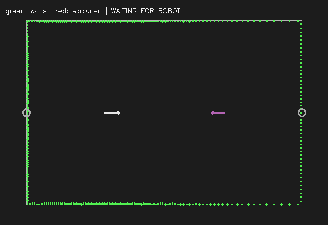
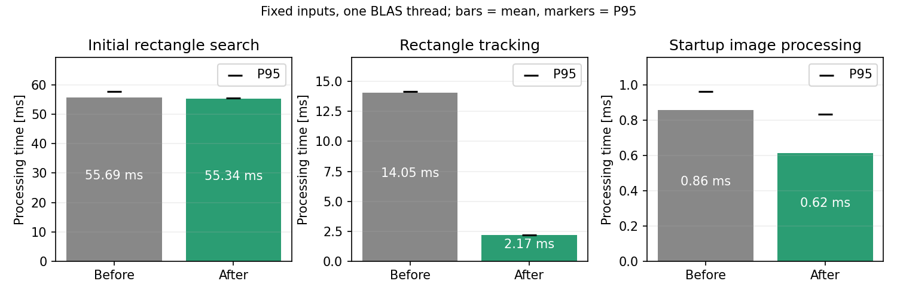
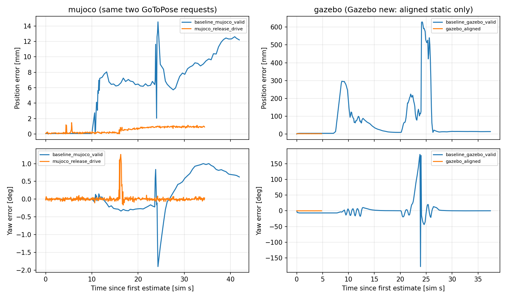

# 공통 경량 Localization 통합 보고 (2026-11-27)

실물·MuJoCo·Gazebo의 기본 MPC 경기 경로를 같은 센서 기반 rectangle Localization으로 통합했다.
초기화는 명시적 신호 뒤 최소각 골대 조준→정지→HLS→IMU 축 확정이며, 경기 중 골대 영상처리는 없다.
**MuJoCo 이동 검증과 Gazebo 정지 초기화는 통과했으나, Gazebo 회전/주행은 기존 구동 정체로 미완이다.
실물 동작을 검증하거나 배포하지 않았다. 따라서 전체 개발 목적을 완전히 달성했다고 보고하지 않는다.**

## 1. 기존 구조 분석

| 환경 | 변경 전 기본 경기 Localization | 확인 수준 |
|---|---|---|
| Pinky Pro | PC `rectangle_localization`: 네 외벽·양 골색 HSV/형상·IMU 기준, PC 명령 gate | 구현 존재; 이전 합성 검사/저장 scan 검증, 실물 정상 동작 확정 아님 |
| MuJoCo | AMCL 500–1500 입자 + map_server + goal_heading(HSV/지자기) | 실제 baseline 실행 |
| Gazebo | MuJoCo와 같은 AMCL 경로 | 실제 baseline 실행; 기존 이동도 실패 |

실물의 기존 rectangle는 초기 신호 대기·네 외벽 정합·양 대칭 후보·센서 시각 정합·
map→odom·LED async·명령 소유권·기록을 이미 구현했다. 이를 재사용했다.
이전에는 양 골색을 모두 볼 때까지 계속 회전했고 경기 중에도 영상 분석을 수행했으며,
일시적인 외벽 상실 때 제한된 odom 예측이 없었다. 최초 탐색/추적 시간도 분리해 측정했다.

| 공통 입력 | 실물 | MuJoCo/Gazebo |
|---|---|---|
| `scan` / LaserScan | 실제 LiDAR | native ray scan → 기존 sensor_adapter |
| `imu_raw` / Imu | 기존 BNO055 NDOF wrapper, base 축 변환 | native IMU → 동일 단위/프레임/실측 잡음 adapter |
| `odom` / Odometry | 실제 wheel odom | 기존 encoder/DiffDrive odom |
| `camera/image_raw/compressed` | 핑키 자체 카메라 JPEG | native camera → 기존 JPEG adapter |
| 센서 TF | 기존 robot_state_publisher/optical TF | 동일 로봇 모델/프레임 구조 |

로봇별 namespace 안의 상대 토픽이다. 프레임 체인은
`map → odom → base_footprint → base_link → sensor links/front_camera_optical_frame`을 유지한다.
외벽 규격·골대 위치는 기존 `pinky_soccer_field.Field`가 선택 YAML에서 읽는다.
공통 알고리즘에 시뮬 spawn/initial_pose/정답 좌표를 넘기지 않는다.

`rectangle_localization → map→odom + localization/pose → 기존 world_model_node(TF 모드)
→ world_model → 기존 BT/Skill/MPC` 순서다. World Model의 노드 코드·형식은 그대로다.
`ground_truth`/`sim/ball_ground_truth`는 기존 평가·UI·심판·시뮬 fixture만 사용한다.
공통 Localization·정상 World Model·MPC·BT는 정답 Pose를 구독/대입하지 않는다.
별도 데모용 `fake_world_model`은 기존 그대로 남지만 정상 game launch에 사용하지 않는다.

## 2. 공통 알고리즘

LaserScan의 비유한/범위 밖 거리를 제외하고 센서 TF로 base 평면의 점 (p_i)를 구한다.
기존 정합기의 각도 후보별 회전 좌표에서 알려진 길이 L/W만큼 떨어진 평행 벽 두 쌍을 찾는다.
히스토그램 지지점·중앙값·네 벽별 최소 점 수·접선 방향 관측 길이·직교성·잔차를 확인한다.
외벽에서 기본25mm 밖의 내부 포인트는 정합에서 제외한다. 원본 scan은 쓰거나 덮지 않는다.
일반 SLAM·입자 필터·점군 registration·추정용 occupancy mapping은 추가하지 않았다.

최초 탐색은 기존 방식을 유지한다. 추적에서는 IMU로 전달한 이전 yaw에서 시작해
채택 벽 점들의 2×2 공분산으로 직선 방향을 최소제곱 보정한다(최대3회).
기존 네 벽/잔차 조건을 만족할 때만 빠른 결과를 쓰며 아니면 기존 각도 탐색으로 돌아간다.
최종 잔차 기본18mm 한도도 적용한다. 네 벽을 충분히 못 보면 pose를 강제로 만들지 않는다.

초기화 전에는 (P=(x,y,\theta)), (P'=(-x,-y,wrap(\theta+\pi)))를 유지한다.
첫 후보의 선택 순서는 좌표계 확정이 아니다. IMU 증분으로 같은 임시 branch를 유지하며 조준한다.
두 짧은 변 중점 (G_i=(\pm L/2,0))과 카메라의 실제 XY/yaw offset을 사용해
카메라 광축 기준 회전각을 구한다:

\[
c = T(P)c_{camera},\quad
\Delta_i=wrap(atan2(G_{iy}-c_y,G_{ix}-c_x)-\theta-\gamma_{camera}).
\]

`abs(Δ)`가 작은 중점을 선택한다. 대칭 후보에서 이 상대 회전은 같으므로 색 확정 전에 조준할 수 있다.
기존 저속 회전 명령/command gate를 재사용한다. 별도 Skill/MPC는 만들지 않았다.
각도 오차 기본0.035rad와 gyro 정지 조건을 만족하면 정지하고0.5초 기다린다.
안정화 이후 **촬영 timestamp**인 영상에만 색 판별을 허용한다.
각 골대에서2.5초 판별 실패 시 반대편을 한 번 시도하고, 둘 다 실패하면 정지·미완료를 유지한다.

640×480의 상단130px를 먼저 제외한다. 한 번만 BGR→HLS 변환한 뒤 두 `inRange`와
`countNonZero`로 판별한다. 기본 요청 범위·500px·비율3·연속3프레임은 공통 YAML에 보존했다.
중복/지연 프레임·중간 불명확 판별·회전 재개는 연속 확인을 끊는다.
Contour·Morphology·경계 검출·Convolution·형상 피팅·YOLO는 이 HLS 경로에 없다.

색과 선택한 임시 중점의 부호로 어느 대칭 후보인지 결정한다. 선택된 실제 LiDAR yaw를 사용해

\[
b=wrap(\psi_{imu}-\theta_{map}),\qquad
\theta_{map}=wrap(\psi_{imu}-b),\qquad
\psi_{blue}=b,\quad \psi_{yellow}=wrap(b+\pi).
\]

관측 당시 raw IMU yaw를 축 각도로 저장하지 않는다. 중심선 밖의 위치·카메라 offset·잔여 조준 오차는
선택된 LiDAR pose의 yaw에 반영된다. 하나의 색만 확정해도 반대 축은 π 차이로 유도한다.
원시 yaw·관측/유도 여부·양 축·offset·초기 pose·유효 상태를 세션별로 저장한다.
좌표계는 그대로 **+X 파랑/−X 노랑**이다. 골대 색과 소속 팀 설정은 독립이다.

## 3. 경기 중 추적·유효 상태

초기화 후 골대 callback은 디코딩 전에 반환한다. 별도 상시 골대/지자기 node도 띄우지 않는다.
odom 상대 이동과 IMU의 wrap된 각도 증분으로 LiDAR 사이를 예측한다.
두 후보 중 IMU offset 예상 yaw에 가까운 쪽을 고르고, 예측 pose와의 혁신량도 확인한다.
기본 위치0.12m·yaw0.25rad·IMU 일치0.5rad 한도를 벗어난 보정은 거부한다.
신뢰할 수 있는 외벽 정합만 IMU offset에 작은 이득0.02로 반영한다.

외벽 상실 때 기본0.8초까지만 odom 예측을 유효하게 쓰며 confidence를 낮춘다.
이후 `LOCALIZATION_LOST`, 3초 뒤 `REINITIALIZATION_REQUIRED`를 latch한다.
새 Trigger/R 없이 자동 회전하거나 큰 위치 보정을 강행하지 않는다.
단발 IMU orientation 이상치는 버리되 연속3회 큰 불연속/기준 단절은 중단한다.
confidence는 시간/수용 여부 기반 경험 지표이며 확률적 정확도 보증이 아니다.

정합 주기는 wall 수신 간격 대신 sensor timestamp로 검사해100ms 스캔이 수신 지터로 번갈아
누락되는 것을 방지했다. 기본10Hz 정합·그 사이 odom 예측/TF를 제공한다.
MPC의100ms 최적화/50Hz 명령 주기는 변경하지 않았다. 준비 후 Twist는 즉시 원본 그대로 전달한다.
기존 `localization/pose`, `ready`, `status`, Trigger 서비스·TF·명령 인터페이스를 유지한다.
status JSON에 진단 필드만 추가했다. map→odom은 해당 경로에서 한 노드만 발행한다.

## 4. 환경 차이·LED·디버그

공통 [설정](../src/pinky_soccer_world_model/config/rectangle_localization.yaml)은 요청 HLS를 그대로 사용한다.
기존 조명의 저장 시뮬 PNG는 명도·채도가 낮아 요청 필터가 골대 대부분을 버린다.
따라서 `localization_config:=auto`의 시뮬에서만
[측정 기반 하한 override](../src/pinky_soccer_world_model/config/rectangle_sim_hls.yaml)를 적용한다:
노랑(24,60,100), 파랑(96,20,80). Hue 범위·상한·면적·비율·연속수·crop은 그대로다.
새 알고리즘/조명/재질 변경이 아니다. 실물 기본은 요청값이며 `localization_config:=none`으로
시뮬도 요청값만 시험할 수 있다. 근거는 [기존 색상 측정](SIMULATION_COLORS.md).
픽셀 수 방식 자체에는 K/D가 필요 없지만 카메라 광축 TF는 필수이고 기존 공 인식의 K/D 요구는 보존한다.

실물 LED는 기존 `pinky_interfaces/SetLed(fill)` 또는 SetLamp를 async 호출한다.
초기화 중 초록 점멸, 완료 후 팀 색이다. 지연/부재가 추정을 block하지 않는다.
시뮬 하드웨어 LED는 끄며 동일 ready/state/팀을 ROS 상태·로그에서 확인한다.
R/Trigger 전에는 데이터만 받고 cmd_vel·LED·map→odom을 발행하지 않는다.

`localization_debug:=true`일 때만 외벽 사본 scan·원본/제외점·직사각형·양 후보·골대 중점·확정 pose·
HLS 마스크를 생성한다. 기존 Localization 창/RViz에서 확인한다. 기존 observed_map/PGM은 debug용으로만 남겼다.
실제 경기 기본은 debug=false이며 정합에 grid를 사용하지 않는다.
status에는 픽셀 수/연속수·선택 중점·IMU offset·유효/초기화 상태·신뢰도·처리 시간·수용/거부 횟수가 있다.



[초기 HLS 마스크](validation/localization_20261127/hls_mask.png),
[확정 pose 화면](validation/localization_20261127/map_ready.png).

## 5. 평가 방법과 정량 결과

같은 하드보드 규격·센서 잡음 기본ON·기존 카메라/조명/물리·기존 MPC cap·acados로 시험했다.
기준선은 명시 `localization:=lidar`, 새 경로는 rectangle다. 외부 실물과 분리한 localhost DDS/GZ partition을 사용했다.
기준선/새 주행은 동일한 두 기존 GoToPose 목표(-0.1,0,0), (-0.1,0,1)을 보냈다.
Ground Truth는 독립 evaluator만 읽어 source timestamp가100ms 이내인 가장 가까운 값을 짝지었다.
RMSE는 해당 pose 메시지 표본 기준이며 일정 시간 간격 가중 RMSE가 아니다.
AMCL은 motion 조건에 따라 pose를 발행하므로 발행 Hz를 내부 연산 Hz로 해석하지 않는다.

단발 비교이며 초기 대기 시간/배경 프로세스 부하를 엄밀하게 통제한 통계 실험은 아니다.
Gazebo의 새 측정은 정지 상태만 통과했으므로 기존 주행 표와 직접 성능 우열 비교하면 안 된다.

| 실행 | x/y RMSE mm | 2D RMSE mm | yaw RMSE ° | pose 발행 Hz | Localization CPU %/1 core |
|---|---|---|---|---|---|
| MuJoCo 기존 AMCL, 2목표 | 7.215 / 1.218 | 7.317 | 0.523 | 2.22 | 38.06 (AMCL+goal_heading) |
| MuJoCo 공통 경로, 2목표 | 0.347 / 0.547 | 0.648 | 0.122 | 17.04 | 36.88 |
| Gazebo 기존 AMCL, 2목표 실패 | 208.677 / 20.271 | 209.660 | 39.541 | 4.44 | 76.31 |
| Gazebo 공통 경로, 골대 정면 정지 | 1.879 / 0.046 | 1.880 | 0.036 | 17.92 | 66.32 |

새 MuJoCo 실행에서 정합 시각 기준 **10.0Hz, 352회 시도/352회 수용**, 거부0회였다.
CPU는 psutil의 해당 Localization 프로세스 user+system 증가량/벽시계 시간으로 계산했다.
시뮬레이터/MPC/UI는 제외하며, 전체 CPU의 유의미한 감소를 입증한 결과는 아니다.

| 계산 구간 | 이전 평균/P95/최대 ms | 변경 후 평균/P95/최대 ms |
|---|---|---|
| 같은 합성 외벽·내부150점, 최초 탐색30회 | 55.69 / 57.71 / 57.94 | 55.34 / 55.58 / 55.84 |
| 같은 입력, 추적30회 | 14.05 / 14.15 / 14.28 | 2.17 / 2.20 / 2.24 |
| 같은 PNG, 초기 골대 영상200회 | HSV/형상 0.860 / 0.963 / 0.988 | HLS/count 0.615 / 0.836 / 1.101 |
| 실제 MuJoCo 공통 노드 정합 | 이전 노드의 동일 동적 계측 없음 | 3.67 / 6.34 / 39.16 (최초 탐색 포함) |
| 실제 Gazebo 공통 노드 정합, 정지 | 동일 계측 없음 | 6.14 / 7.57 / 79.91 (최초 탐색 포함) |

합성 계산은 동일 입력·BLAS thread1로 측정했다. 이전/현재 최초 탐색 pose와 잔차는 동일하다.
추적 잔차 RMS는 이전2.764mm→2.752mm였다. 전체 알고리즘 시간과 solver 시간을 혼동하지 않는다.
경기 중에는 골대 영상 처리 자체를 호출하지 않는다(별도 ROS 회귀 검사 포함).





원본 평가 로그 gzip·[결과 JSON](validation/localization_20261127/results.json)·
[동일 시각축 pose CSV](validation/localization_20261127/poses.csv)·
[계산 시간 원본](validation/localization_20261127/math_timing.json)을 보존했다.
[rebuild.py](validation/localization_20261127/rebuild.py)는 보존한 raw에서 CSV/표/오차 그래프를 재생성한다.

## 6. 초기화·필수 시나리오 결과

| 실행/상황 | 결과 |
|---|---|
| MuJoCo (-0.4,0,0), 실측 렌더 HLS | 파랑 하나로2.843초 READY; 누적 IMU 회전0.0128rad(정지 잡음 포함) |
| MuJoCo (0.55,-0.3,π/2), 측면·중심선 밖 | 6.062초 READY; 회전0.8715rad, 2D RMSE0.966mm |
| MuJoCo (0.55,-0.3,-2.8), 가까운 파랑/최소각 노랑 | 먼 노랑을 선택,5.061초 READY; 회전0.5529rad, 2D RMSE0.508mm |
| MuJoCo 요청 기본 HLS만 사용 | 첫 파랑 판별 실패→반대 노랑1000px/3프레임→17.345초 READY; 회전3.205rad |
| Gazebo 초기 정면 정렬 시험 | 5.340초 READY; 관측 파랑5063px, 노랑25px |
| MuJoCo 정적 상대·곡선·기존 벽/상대 회피ON | 2.942초 READY, 두 곡선 목표 모두 SUCCESS; 2D RMSE0.621mm, yaw RMSE0.234°, 정합10Hz |
| Gazebo 회전 필요한 기본 자세 |0.3/0.5rad/s 전달에도 실제 yaw 정체; 미완료 유지 |

시간은 launch 시작부터 첫 READY 수신까지이며 드라이버 시작/발견 시간을 포함한다.
회전량은 raw IMU의 wrap된 절대 증분 누적이라 정지 잡음을 포함한다.
서로 다른3개 MuJoCo 시작 자세는3/3 초기화, 추가 strict-HLS fallback도 성공했다.
이는 전체 공간/조명/장애물에 대한 통계적 성공률이 아니다.
새 측정 pose의 잘못된 π branch/0.25m 또는0.7rad 이상의 연속 표본 점프는0회였다.
기존 Gazebo baseline에는 yaw 오차90° 초과 구간1회와 큰 pose 점프1회가 있었다.

합성 ray/ROS 검사는 중앙·네 모서리·양 골대/측면·off-axis·거리/회전 조건 불일치·
중앙 상대·벽 근처 상대·외벽 일부 가림·비유한 거리·다른 잡음 수준·첫/양 골대 판별 실패·
±π 통과·IMU drift·큰 보정 거부·단기 odom 예측·장기 재초기화 latch를 포함한다.
상대는 ray/circle fixture이며 전체 실제 로봇 메시/카메라 가림을 모두 재현한 시험은 아니다.
실제 골대 가림·전 구간의 움직이는 상대·오랜 IMU drift·모든 RCJ 자세는 추가 검증 대상이다.

## 7. 기존 기능 보존과 회귀

- World Model/공 인식/방향 보정/공통 Localization/launch: 최종 기능 회귀130 tests PASS.
- 기존 MPC 기능73 tests PASS(acados·예정 입력·지연/observer·모터응답·회피 포함).
- 기존 BT/Skill CTest3개 suite PASS: gtest24 + catalog3 tests.
- MuJoCo 기존/새 경로 모두 위 두 GoToPose 요청2/2 SUCCESS.
  별도 namespace 장면에서 정적 상대를 두고 기존 벽/상대 회피를 켠 두 곡선 목표도2/2 SUCCESS였다.
  목표는(-0.15,0.15,0.6), (-0.3,-0.1,-1.2)이며 상대는(0.2,0)에 고정했다.
  상대가 경로를 완전히 막는 모든 회피 상황을 검증한 것은 아니다.
- Python F 검사·컴파일·두 PC 패키지 symlink 빌드. 전체 스타일 lint의 통과를 주장하지 않는다.
- [보존 검사](validation/localization_20261127/preservation.json): 작업 전 MPC·물리·BT·공 인식·World Model의
  기존 dirty diff 및 소스17항목 동일. 이번 작업으로 그 코드·비용·제약·주기·물성·규격·센서 설정을 바꾸지 않았다.
  전 단계 색상 변경/모터τ/진단 작업의 미커밋 변경도 유지했다. 커밋/하드웨어 배포는 하지 않았다.

## 8. 수정 파일과 재사용

- [rectangle_localization.py](../src/pinky_soccer_world_model/pinky_soccer_world_model/rectangle_localization.py): 기존 정합 + 빠른 추적 LS.
- [rectangle_localization_node.py](../src/pinky_soccer_world_model/pinky_soccer_world_model/rectangle_localization_node.py): 기존 센서/TF/게이트/LED/저장 재사용, 공통 상태·추적 통합.
- 신규 [goal_hls.py](../src/pinky_soccer_world_model/pinky_soccer_world_model/goal_hls.py),
  [rectangle_tracking.py](../src/pinky_soccer_world_model/pinky_soccer_world_model/rectangle_tracking.py), 위 config YAML2개.
- 기존 `pinky_soccer_viz/robot_stack.py`, `localization_view.py`, `launch/{game,real_game,sim_field}.launch.py`:
  공통 기본·설정/디버그 전달·기존 UI 확장. Nav2 비교는 기존 AMCL 선택 경로를 유지한다.
- 기존 rectangle/launch 검사 갱신 + 신규 `test_lightweight_localization.py`.
- 신규 [benchmark_localization.py](../scripts/benchmark_localization.py), 이 보고서/평가 자료,
  STARTUP_LOCALIZATION·기존 LOCALIZATION·루트/두 패키지 README·ARCHITECTURE 갱신.

신규 패키지·런타임 라이브러리는 없다. 평가 CLI는 기존 PC의 numpy/OpenCV/psutil/ROS를 사용한다.
기존 AMCL `localization:=lidar`와 `odom_only`를 제거하지 않았다. 기존 rectangle 파일은 작업 전
`/tmp/pinky-localization-before/`에 보존했고 기존 제어/추정 주변 코드는 원형 유지 검사를 했다.

## 9. 실행·실물 후속·남은 문제

정확한 PC/핑키 명령·Trigger/R/S·설정은 [실행 절차](../src/pinky_soccer_world_model/STARTUP_LOCALIZATION.md)에 있다.

```bash
source /opt/ros/jazzy/setup.bash
.venv/bin/python -m colcon build --symlink-install --packages-select pinky_soccer_world_model pinky_soccer_viz
source install/setup.bash
ros2 launch pinky_soccer_viz game.launch.py mode:=mujoco verify:=true localization_debug:=true
# 다른 터미널, 같은 ROS/domain:
ros2 service call /localization/calibrate std_srvs/srv/Trigger '{}'
# 하나씩 실행; mode:=gazebo 또는 mode:=real로 변경 가능(아래 미검증 사항 확인).
```

독립 평가(실물을 연결하지 않으며 localhost DDS/임의 GZ partition만 사용):

```bash
.venv/bin/python scripts/benchmark_localization.py --sim mujoco --drive --output /tmp/loc-new
.venv/bin/python scripts/benchmark_localization.py --sim mujoco --localization lidar --drive --output /tmp/loc-old
.venv/bin/python scripts/benchmark_localization.py --sim mujoco --duration 5 --output /tmp/loc-corner \
  --extra initial_x:=0.55 initial_y:=-0.30 initial_yaw:=1.57079632679
.venv/bin/python docs/validation/localization_20261127/rebuild.py
```

실물은 기존 핑키에서 `robot.launch.py imu_enabled:=true`와 기존 LED 서버를 사용하고,
PC만 새 `mode:=real ... camera_yaml:=<실제파일>`로 재실행한다. 이번 변경 때문에 핑키 내부 코드를
교체할 필요는 없다. 다만 기존 NDOF wrapper의 유효 quaternion/TF가 설치돼 있어야 한다.
단일 I2C/GPIO 소유자·IMU 축/장착·stamp/chrony·JPEG 방향·HLS 조명·외벽 가림·저속 회전·실제 LED를 확인한다.
처음에는 verify 모드·낮은 기존 속도 한계를 유지하고 신호 전 무제어→초기화→짧은 GoToPose 순서로 bag을 수집한다.

**Gazebo 미해결:** 독립 시험에서 `cmd_vel`, `drive/cmd_vel`, `drive/motor_cmd_vel` 모두
−0.3 또는−0.5rad/s였지만 실제 pose는 x≈−0.401882,y≈−0.003636,yaw≈0.118022로 고정됐다.
같은 조건의 변경 전 AMCL GoToPose 두 목표도 FAILURE였다.
ROS 명령 생성/게이트 이후의 ROS–GZ 전달·구동·물리 경로를 추가 확인해야 하며 정확한 원인은 아직 확인하지 않았다.
이번 Localization 범위를 지키기 위해 물성/모터/브리지 코드를 임의로 바꾸지 않았다.
목표각에 도달하지 못할 때 HLS 확정/READY/명령 통과로 우회하지 않는다.
따라서 Gazebo 임의 시작 자세·동적 주행 회귀, 실물 전체 주행 검증은 완료 상태가 아니다.
